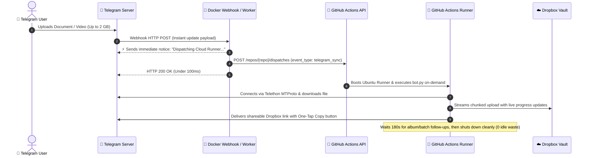

# ⚡ Serverless Telegram to Dropbox Dispatch Engine
### Webhook Gateway + GitHub Actions Dispatch + Docker

This module transforms the 24/7 polling daemon into a **true on-demand serverless architecture**. Your sync engine only runs when a user uploads a file or sends a command, keeping **100% of your GitHub Actions free tier quota** intact while still supporting **files up to 2 GB** via Telethon (MTProto).

---

## 🏛️ How It Works



---

## 🚀 Quick Setup Guide

### Step 1: Create a GitHub Personal Access Token (PAT)
The Webhook server needs a PAT to trigger GitHub Actions on your behalf:
1. Go to **GitHub Settings** ➔ **Developer Settings** ➔ **Personal access tokens** ➔ **Tokens (classic)**.
2. Click **Generate new token (classic)**.
3. Note: `Telegram Webhook Dispatcher`.
4. Select scope:
   - ✅ **`repo`** (Full control of private repositories) or **`public_repo`** (for public repos).
5. Copy the generated token (`ghp_...`).

---

### Step 2: Configure Environment Secrets

Create a `.env` file in the root of the project:
```bash
cp .env.example .env
```
Populate your credentials in `.env`:
* `TELEGRAM_BOT_TOKEN`: From `@BotFather`
* `TELEGRAM_API_ID` & `TELEGRAM_API_HASH`: From [my.telegram.org](https://my.telegram.org)
* `GH_REPO`: Your repository name (e.g. `DexterDevKH/TelegramDropboxBot`)
* `GH_PAT`: Your GitHub Personal Access Token from Step 1
* `AUTHORIZED_USER_IDS`: Your Telegram numeric ID (from `@userinfobot`)
* `DROPBOX_APP_KEY`, `DROPBOX_APP_SECRET`, `DROPBOX_REFRESH_TOKEN`: From Dropbox Developer Portal

> [!IMPORTANT]
> Ensure the same secrets (`TELEGRAM_BOT_TOKEN`, `TELEGRAM_API_ID`, `TELEGRAM_API_HASH`, `DROPBOX_*`, `AUTHORIZED_USER_IDS`) are also added to **GitHub Repository Settings ➔ Secrets and variables ➔ Actions**.

---

### Step 3: Run the Webhook in Docker

Start the lightweight Webhook Dispatcher container:
```bash
docker compose up -d webhook
```

Verify that the container is healthy:
```bash
docker compose ps
curl http://localhost:8080/health
```

Expected response:
```json
{"status": "healthy", "service": "Telegram-Dropbox Webhook Dispatcher", "repo": "DexterDevKH/TelegramDropboxBot", "pat_configured": true}
```

---

### Step 4: Expose Webhook to the Internet (HTTPS)

Telegram requires an **HTTPS** endpoint. Choose one of the following:

#### Option A: Cloudflare Tunnel (Zero Port-Forwarding, Free)
Run the built-in tunnel profile:
```bash
TUNNEL_TOKEN="your_cloudflare_tunnel_token" docker compose --profile tunnel up -d
```

#### Option B: Ngrok (Quick Testing)
```bash
ngrok http 8080
```
Copy the generated `https://...ngrok-free.app` URL.

#### Option C: Reverse Proxy (VPS / Nginx / Caddy / Traefik)
Point your public domain (e.g., `https://bot.yourdomain.com`) to port `8080`.

---

### Step 5: Register the Webhook with Telegram

Use the included [auto_setup.py](file:///c:/Users/Dexter/Documents/GitHub/TelegramDropboxBot/webhook/auto_setup.py) tool to set your webhook URL in one command:

```bash
# Register your public URL
python webhook/auto_setup.py --set-url "https://your-domain.com/webhook"

# Or if using a secret verification token:
python webhook/auto_setup.py --set-url "https://your-domain.com/webhook" --secret "my_secret_token"
```

Verify registration status:
```bash
python webhook/auto_setup.py --info
```

---

### Step 6: Test the Pipeline

1. **Simulate a Dispatch Test:**
   ```bash
   python webhook/auto_setup.py --dispatch-test
   ```
   Check your GitHub repository's **Actions** tab. You should see a workflow run triggered by `repository_dispatch`!

2. **Send a Real File in Telegram:**
   - Send any document, archive, or video to your bot in Telegram.
   - The bot will instantly reply:
     > ⚡ **TRANSFER REQUEST RECEIVED**
     > 📄 Target: `video.mp4` (150 MB)
     > 🛰️ Status: *Dispatching GitHub Actions cloud runner...*
   - Within 25–30 seconds, GitHub Actions boots up, downloads the 150 MB file via Telethon MTProto, uploads it directly to Dropbox, prunes FIFO files, and returns the one-tap copy button!

---

## ☁️ Alternative: Cloudflare Workers (No Docker Server Needed)

If you don't want to run Docker on a server, deploy the included Cloudflare Worker:

1. Install Wrangler CLI:
   ```bash
   npm install -g wrangler
   ```
2. Navigate to `webhook/` and publish:
   ```bash
   cd webhook
   wrangler secret put GH_PAT
   wrangler secret put TELEGRAM_BOT_TOKEN
   wrangler secret put AUTHORIZED_USER_IDS
   wrangler deploy
   ```
3. Register the generated worker URL with `auto_setup.py`:
   ```bash
   python auto_setup.py --set-url "https://telegram-dropbox-sync-trigger.your-name.workers.dev"
   ```

---

## 🛠️ CLI Management Utilities

The [auto_setup.py](file:///c:/Users/Dexter/Documents/GitHub/TelegramDropboxBot/webhook/auto_setup.py) script provides diagnostics and controls:

| Command | Action |
| :--- | :--- |
| `python webhook/auto_setup.py --info` | View current Telegram webhook status, errors, and update counts |
| `python webhook/auto_setup.py --set-url <URL>` | Set/update the Telegram webhook destination |
| `python webhook/auto_setup.py --delete` | Remove the webhook and return to polling mode |
| `python webhook/auto_setup.py --test-tg` | Verify Telegram Bot token credentials |
| `python webhook/auto_setup.py --test-gh` | Verify GitHub PAT connectivity and repo permissions |
| `python webhook/auto_setup.py --dispatch-test` | Trigger a test GitHub Actions run via API |

---

## ❓ Frequently Asked Questions

#### Q: How much does this cost?
**$0.00 / completely free.**
* **Webhook Server (Docker):** Runs on ~15MB RAM.
* **GitHub Actions:** Standard free tier gives **2,000 minutes/month**. Because each transfer takes only ~1–2 minutes, 2,000 minutes gives you ~1,000 to 2,000 on-demand transfers per month without paying a penny.
* **Dropbox API:** Free tier.

#### Q: What if I send multiple files at once (e.g. an album)?
The runner has a built-in `IDLE_KEEP_ALIVE_SECONDS=180` (3 minutes) window. It processes the first file, stays awake to catch any follow-up files or albums in real-time without starting new GitHub jobs, and automatically terminates once the queue is idle.
